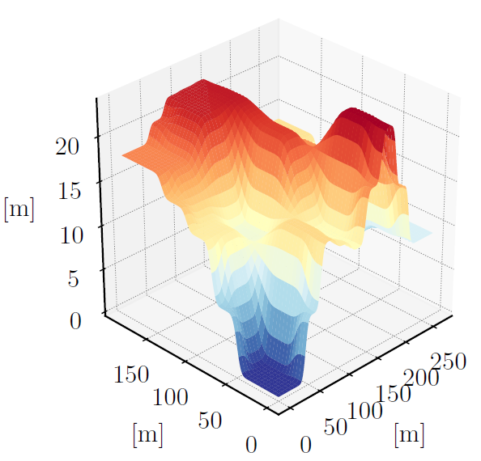

# User guide

## Executable options

The main MOMA executable is available on PATH on all Docker images as `moma`. The main subcommand for MOMA is `mobility` which generates mobility maps. Furthermore subcommands exist for generating a synthetic test map and generating a vehicle mobility file from multibody dynamics simulation.

```{csv-table} Executable options
:widths: 20, 50, 15, 15
:header-rows: 1

Key, Description, Type [Range], Default value
\\-\\-clear, Clear the console before running the script, bool flag, False
mobility, Subcommand for predicting mobility, subcommand, —
generate_test_map, Subcommand for generating synthetic test maps, subcommand, —
generate_vehicle_mobility_file, Subcommand for generating vehicle mobility file with data from DYNO, subcommand, —
```

### Mobility arguments

The output of the mobility generation is a set of mobility maps that tells the mobility for a giving vehicle in a given travel direction.

The mobility map generation has the following arguments

```{csv-table} Executable options
:widths: 30, 50, 15, 15
:header-rows: 1
:delim: ;

Key; Description; Type [Range]; Default value
\\-\\-show_plots; Show popup windows with generated plots (mobility); bool flag; False
\\-\\-vehicle; Name of the vehicle to use (vehicle folder name); str; mock
\\-\\-site; Name of the site (site folder name); str; testmap
\\-\\-n_samples; Number of samples used for uncertainty handling (1 → mean value); int ≥1; 1
\\-\\-sample_reduction; Sample reduction method ('mean' or 'quantile q'); list; mean
\\-\\-path; Path to MOMA data root; str; data/
\\-\\-path_coordinate_system; Coordinate system for path planner (map or utm). Setting the coordinate system activates path planning; str; None
\\-\\-path_start; Start waypoint for path planner (x y); int×2; 0 0
\\-\\-path_end; End waypoint for path planner (x y); int×2; 0 0
\\-\\-path_folder; Folder with predefined paths for mobility calculations; str; —
\\-\\-dont_export; Disable exporting plots. Makes the calculation faster at debugging; bool flag; False
\\-\\-directions; Directions for directional mobility. Accepted inputs: 'omni', angle in degrees or abbreviations ('N', 'NNE', 'NW', etc.) Defaults to the eight primary directions if no directions are given in both \\-\\-directions and \\-\\-n_directions; list[str]; —
\\-\\-n_directions; Number of equally spaced directions used together with directions specified by \\-\\-directions; int ≥0; 0
\\-\\-save_maps; Save generated maps as GeoTIFF; bool flag; False
\\-\\-hide_utm; Hide UTM axis values in plots; bool flag; False
\\-\\-minimum_speed; Minimum speed for the mobility calculation; float >0; 0.5
\\-\\-target_speed; Target speed for the mobility calculation; float >0; 10.0
```

#### Calculation mobility metrics for paths
MOMA can fill in mobility metrics for specified path. To do this the `--path_folder` argument is used to specify a folder where the paths are located.
Each path is a subfolder with the name `path-some_name` where `some_name` is the name of the path. The path folder most contain a json file with coordinates of the path specified in the following structure:

```json
{
    "waypoints": [
        {
            "map": {
                "x": 12.5,
                "y": 97.5
            }
        },
        {
            "map": {
                "x": 17.5,
                "y": 97.5
            }
        },
        {
            "map": {
                "x": 22.5,
                "y": 97.5
            }
        }
    ]
}
```

The mobility metrics will be added directly to each such file in the specified folder. 

### Map generation arguments

A synthetic testmap can be generated for use in MOMA. It consist of flat plateaus with slopes between them. The map can be padded with flat terrain around it.
All distances are in meters.


```{csv-table} Executable options
:widths: 20, 50, 15, 15
:header-rows: 1
:delim: ;

Key; Description; Type [Range]; Default value
\\-\\-N_maps; Number of test maps to generate; int ≥1; 1
\\-\\-elevation_std; Elevation noise standard deviation; float ≥0; 0.0
\\-\\-friction_coefficient; Base friction coefficient; float 0–1; 0.5
\\-\\-friction_coefficient_std; Friction coefficient standard deviation; float ≥0; 0.0
\\-\\-output; Output directory; str; data/sites/testmap
\\-\\-map_type; Generated map file type (bmp or obj); str; bmp
\\-\\-output_resolution; Output resolution multiplier. Resolution = 0.25 m*multiplier; int ≥1; 6
\\-\\-create_rasters; Create MOMA-compatible rasters; bool flag; False
\\-\\-plot_additional_files; plots slope histogram and rendering of the map; bool flag; False
\\-\\-seed; Seed for random map generation; int; 2
\\-\\-coordinates_lower_left; UTM Coordinates (easting, northing) of the lower left corner of the map; int×2; 0 0
\\-\\-max_slope_percent; Maximum terrain slope; float %; 20.0
\\-\\-map_dim; Map dimensions (x y); int×2; 200 200
\\-\\-plateaus; Number of plateaus (x y); int×2; 4 4
\\-\\-slope_length; Length between plateaus (x y); int×2; 30 30
\\-\\-resolution; Pixels per meter; int ≥1; 4
\\-\\-start_pad; Flat padding around map; int ≥0; 10
\\-\\-transition_pad; Transition padding between the flat padding and generated map; int ≥0; 15
```

### Vehicle mobility file generation arguments

A vehicle mobility file for use in MOMA can be generated from vehicle simulations done with [DYNO](https://github.com/au-agv/dyno). Currently only slope climbing for straight line acceleration on hard surfaces with varying coefficient of friction is supported. The output from DYNO should be placed inside the a subfolder to the vehicle named `straight_line_acceleration`. 


```{csv-table} Executable options
:widths: 20, 50, 15, 15
:header-rows: 1
:delim: ;

Key; Description; Type [Range]; Default value
\-\-vehicle; Name of the vehicle to generate the mobility file for; str; —
\-\-minimum_speed; Minimum allowed speed in the generated mobility file; float ≥0; 0.01
\-\-plot; Plot the data from the generated mobility file; bool flag; False
```


## Adding a New Site

New sites can be added to MOMA by creating a dedicated directory under
`sites`.

Each site directory must contain a `site.yaml` file that defines the site
configuration.

The `site.yaml` file includes the following information:

- **Data source identifier**  
  A keyword specifying which data source or data loader should be used.

- **Site extent**  
  The west, south, east, and north boundaries of the site, defined as a bounding
  box in **Universal Transverse Mercator (UTM)** coordinates.

- **Mobility interpolation**  
  `ClipMobilityToRange: true` uses the absolute slope and returns zero speed
  for slopes outside the tabulated vehicle range. The default (`false`) keeps
  the historical linear extrapolation. The CLI equivalent is
  `--clip_mobility_to_range`.

- **No-go policy**  
  `HardNoGo: true` removes graph edges touching zero-speed cells, so a route
  cannot cross no-go land use or slopes beyond the vehicle limit. The default
  (`false`) keeps the historical soft penalty. The CLI equivalent is
  `--hard_no_go`.

- **No-go zones**  
  A list of areas that the vehicle must avoid. No-go zones may be specified as
  either rectangular regions or circular regions.

Based on this configuration, MOMA automatically creates the required directory
structure and loads the relevant data from the specified data source.


## Adding a New Data Loader

If a site lies outside the geographical coverage of the existing data loaders, or
if it relies on a different data source, a new data loader must be implemented.

To add a new data loader, create a new class in `src/moma/dataloader.py`. This class
must then be registered in the `get_dataloader` function, which instantiates the
appropriate data loader based on the information provided in the `site.yaml` file. Additionally a subfolder with the dataloader name must be made in `data/dataloaders`. This sub folder should contain three files: `landuse_mapping.yaml`, `moisturecontent_mapping.yaml`, and `soiltype_mapping.yaml`. These file contain the mapping from the data input encoded as colors to values that MOMA can use

A data loader should implement functionality to:

- retrieve data from the specified data source,
- convert the data into the raster format used by MOMA, and
- ensure consistent grid resolution and geographical extent across all generated
  maps.

To improve performance and reduce unnecessary data downloads, data loaders should
preferably generate the required raster files once and store them locally for reuse.

:::{warning}
MOMA does not validate grid size or geographical consistency. It is therefore the
responsibility of the data loader to ensure that all generated maps are spatially
consistent.
:::

## Adding a New Vehicle

A vehicle is defined by its `mobility.yaml` and `landuse_nogo.yaml`. The mobility file contains information of maximum steady state vehicle speeds for a set of tests. For a simple slope climbing test the subcommand `--generate_vehicle_mobility_file` can be used to fill in the mobility file. Here is an example of the start of one such file presented:

```yaml
- soil:
    type: sideslope
  test:
    type: sideslope
    slope_angle: 0.0
  value: 20.0
- soil:
    type: sideslope
  test:
    type: sideslope
    slope_angle: 20.0
  value: 0.0
- soil:
    type: HT
    friction_coefficient: 0.0
  test:
    type: slope
    slope_angle: 0.0
  value: 14.14
- soil:
    type: HT
    friction_coefficient: 0.1
  test:
    type: slope
    slope_angle: 0.0
  value: 14.83
```

`landuse_nogo.yaml` contains information on which landuses the vehicle can safely transverse.


```{toctree}
:hidden:
components/index.md
```
