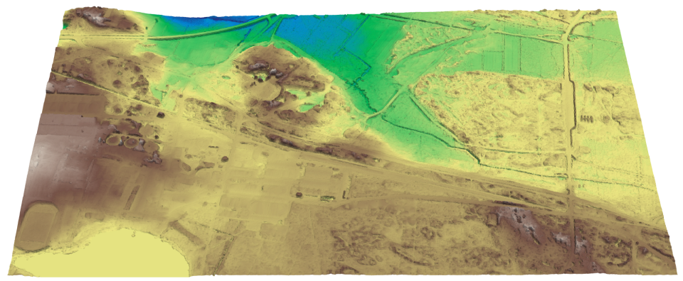
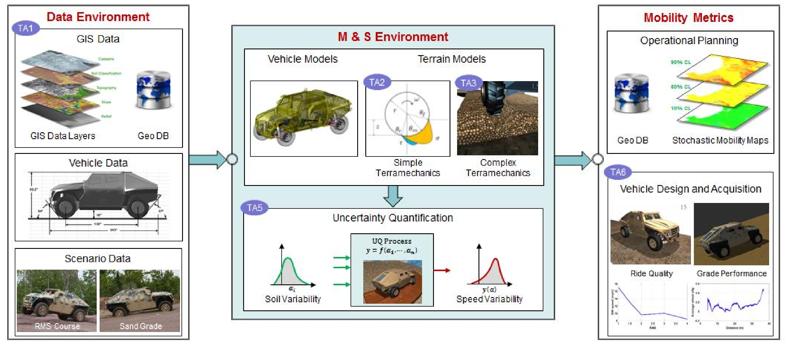
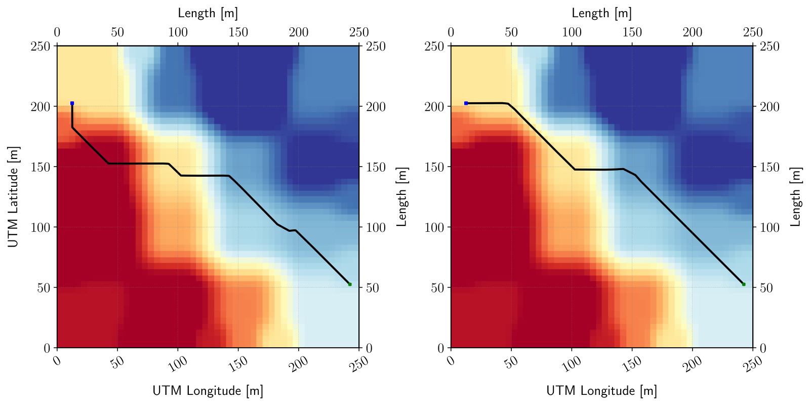
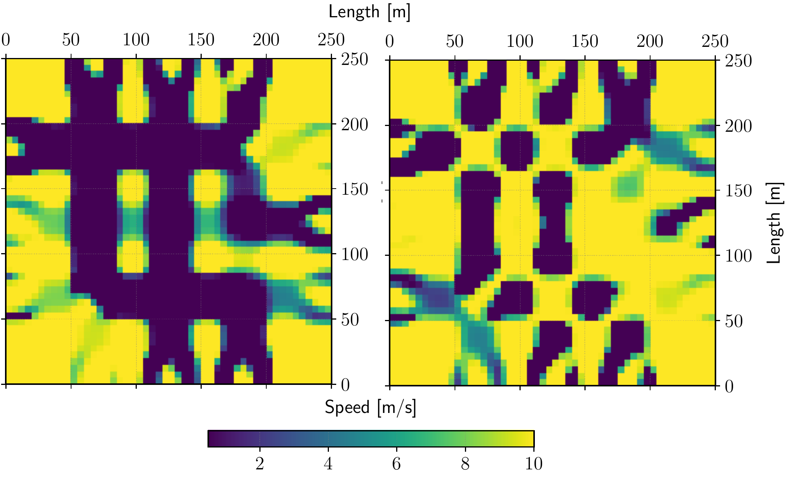
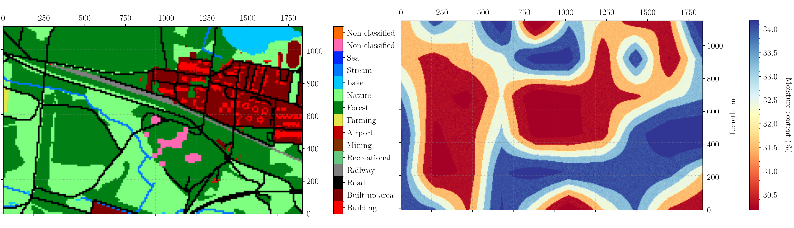
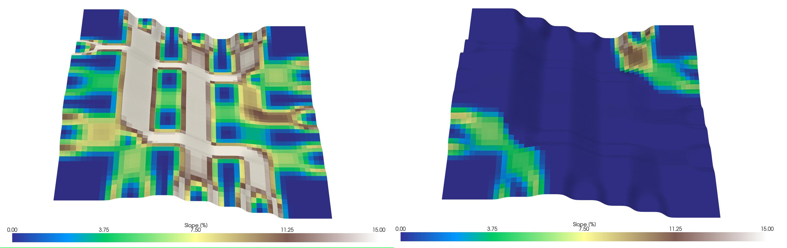

# Summary

MOMA is a Python package designed to streamline mobility mapping from vehicle
performance data. It integrates Geographic Information System (GIS) raster data
(such as the elevation data shown in Figure
\ref{fig:moma-omnidirectional-vs-directional-optimal-path-comparison}) to define
site specifications and assess how easily, efficiently, and safely vehicles
navigate between locations on a map.

Using MOMA, users can generate mobility maps based on omnidirectional (averaged)
slope information or directional slope maps in the cardinal and inter-cardinal
directions, as well as terrain friction characteristics, providing a recommended
traversal speed over the entire imported terrain. MOMA can also be used for path
planning, finding optimal, safe and directionally-aware maximum speed paths
connecting any two map cells.

The mobility maps can be generated from omnidirectional slope data or
directional slopes in cardinal and inter-cardinal directions (Figure
\ref{fig:omnidirectional-vs-directional-slope-map-comparison}), along with
terrain friction characteristics. These inputs, when coupled with simulated or
tested vehicle performance data, determine the recommended traversal speeds
across the imported site. Additionally, MOMA provides path planning capabilities
to identify optimal routes that prioritize speed while accounting for safety and
directional challenges between any two locations on the map (Figure
\ref{fig:moma-omnidirectional-vs-directional-optimal-path-comparison}).

{height="180pt"}

MOMA can export mobility maps in GeoTIFF or PDF format. MOMA can be used to
generate example maps for capabilities verification using an external vehicle
simulation software. The maps can be exported in GeoTIFF, BMP or as meshes in
OBJ format. MOMA can visualize elevation, slope, generic property maps (e.g.
moisture content, friction coefficient) and categorical maps (soil type, land
use), and can parse site land use information to augment the generated maps with
untraversable areas based on their category. Users can also manually specify
portions of the map to be marked as go/no-go zone during mobility map generation
or path planning.

# Statement of need

Vehicle mobility analysis is critical in assessing whether a ground vehicle
(wheeled or tracked) can navigate varied terrains and conditions without risking
immobilization, damage, or endangering its occupants.

Recent advancements have shifted the focus of these analyses toward
software-driven approaches, enabling faster development and selection of
high-performance vehicles while minimizing the costs, risks, and time demands
traditionally tied to physical testing. The growing sophistication of vehicle
simulation tools has highlighted the demand for streamlined, integrated
workflows for mobility analysis grounded in scientific validation.

{height="180pt"}

Especially influential in this context is the NATO Next-Generation NATO
Reference Mobility Model [@nato2021guidance] (Figure
\ref{fig:nato-ng-nrmm-framework}), a shared computer modelling framework for the
prediction of the mobility of ground vehicles across different environments. The
primary goal of the framework is to provide quantitative estimates indicating
where vehicles should traverse, at what maximum speed, and how safely, using
validated [@gorsich2023cooperative] simulation tools above physical testing
alone.

Contrary to older models, such as the previous [@ahlvin1992nato] NATO Reference
Mobility Model (NRMM), NG-NRMM incorporates the combined used of high-fidelity,
three-dimensional vehicle models, multi-layer geographical information systems
(GIS) data, various levels of fidelity for vehicle-terrain interaction, the
generation of optimal routes and the incorporation of uncertainty in input data
related to the vehicle, the environment, or both.

{height="180pt"}

# State of the field

Contrary to its predecessor, NG-NRMM does not provide an integrated software
toolset to perform mobility analyses, but rather prescribes the architecture,
requirements and, to a degree, a common standard for software to be developed
around. While this encourages the extension of legacy simulation frameworks to
adopt the new standard and ultimately promotes the development of independent
software solutions, to the best of our knowledge, no open-domain solutions exist
at the time of writing.

While many popular GIS software solutions are available in the public domain,
both as comprehensive software suites (such as the popular [@graser2025qgis]
QGIS) or as libraries (such as [@contributors2020gdal] [GDAL](https://gdal.org),
[@gillies2013rasterio] [Rasterio](https://pypi.org/project/rasterio/),
[@bossche2025geopandas] [GeoPandas](https://geopandas.org),
[@hagen_zanker2018pronto] [Pronto Raster](https://ahhz.github.io/raster/)), none
are specifically tailored to mobility analyses, and significant development
efforts are required to process the geographical site data and the vehicle
performance data into mobility data through maps or paths.

{height="180pt"}

# Software design

MOMA adopts a modular architecture closely following the relevant parts of the
framework illustrated in Figure 1. Users interact with the system via a
command-line interface (CLI) that exposes its core functionalities: the site
definition (by means of generation or import), the mobility map generation, and
the optimal path planning.

The `Dataloader` module handles raster data imports from local or remote
sources. Once loaded into memory, the data is parsed based on its type and
contents to support downstream processing: the loaded rasters can be continuous
(e.g., aerial views, elevation, moisture, etc.) or categorical (e.g., land use,
soil type). Users are encouraged to implement a custom `Dataloader`
specialization to accommodate their specific GIS data formats, as stored file
formats and data classification conventions vary widely across datasets.

A YAML-formatted vehicle performance definition, typically derived from vehicle
test data or vehicle simulation results, serves as input alongside site raster
data. MOMA constructs a surrogate model (through the `MobilityTensor`
abstraction) from this sparse dataset before interpolating its predictions
across the full parameter space defined by the terrain inputs. 

{height="300pt"}

MOMA processes each (inter-)cardinal directional raster as an independent input.
For single(omni)-directional analyses, it generates one output mobility map,
while multi-directional inputs with cardinality higher than the compass
directions yield interpolated results reflecting the combined influence of
neighboring cells.

The path planning module relies on the A\* algorithm to compute weighted
shortest paths across a dense graph derived from raster cell adjacency of the
the aggregated mobility maps. The optimization prioritizes minimal traversal
time while incorporating sideslope penalties (where applicable, i.e. for
multi-directional mobility analyses).

MOMA integrates convenient visualization tools for 2D and 3D rendering of
continuous and categorical raster data using [@hunter2007matplotlib]
[Matplotlib](https://matplotlib.org/) and [@sullivan2022pyvista]
[PyVista](https://pyvista.org/), provided as specialized plotting functions
based on the type of parsed data. Optional calls for showing and exporting the
generated plots are exposed via the command line interface.

Additionally, a map generation module provides, separately from the rest of the
codebase, parametric terrain creation with user-specified elevation statistics.
This is a suitable workflow for testing in the absence of real world raster
data, but may also be used to generate a reference map for verification purposes
in support of vehicle simulation workflows.

# Research impact statement 

MOMA enables researchers to perform next-generation mobility analysis with
minimal setup requirements. By abstracting map generation pipelines into a
Python package, it allows users to focus on vehicle selection for specific
mobility challenges rather than pipeline development.

Scientists and engineers in the mobility community retain full control over the
parsing of vehicle performance data into mobility maps and benefit from a
unified framework suitable for verification and validation studies. We see this
initiative as an initial, yet meaningful step toward democratizing access to
NG-NRMM capabilities, specifically in the context of handling geographical
terrain inputs and integrating vehicle performance data.

{height="180pt"}

We acknowledge that MOMA currently implements only a subset of the inputs
defined by the NG-NRMM framework and does not fully adhere to STANREC 4813
[@sciencestanrec] file format specifications. However, its design prioritizes
simplicity for mobility verification and validation, requiring minimal raster
data and vehicle performance inputs, resources readily accessible through public
sources.

# AI usage disclosure

Limited parts of this software package were developed with the assistance of
generative AI tools for the scope of refactoring, review and augmentation.

Specifically, methods related to just-in-time (JIT) compilation and to the
command-line interface were developed with the assistance of GitHub Copilot. A
portion of the Python docstrings for module functions and class methods were
generated with the assistance of a local LLM based on Qwen3.

We emphasize that, in all circumstances, a human retained full supervision,
direction, and control over the implementation of all source code.

# References